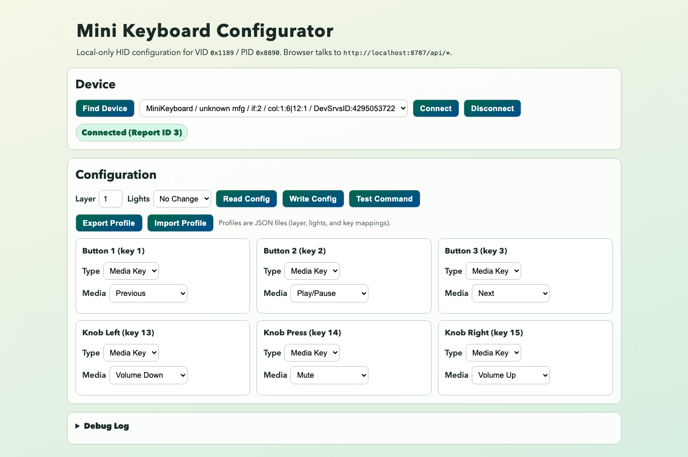

# Mini Keyboard Configurator (macOS, local-only)

Local configurator for the AliExpress MiniKeyboard (3 buttons + 1 knob with left/press/right actions).

- Device: VID `0x1189`, PID `0x8890`
- No browser WebHID usage
- Python backend talks to USB HID directly
- Local web UI at `http://localhost:8787`

## Screenshot



## Quick Run On Your Mac

This is the fastest way to run it from Terminal or iTerm.

```bash
git clone https://github.com/niels-emmer/mini-kbd-configurator.git
cd mini-kbd-configurator
./run-mac.sh
```

What `run-mac.sh` does:
- checks for Python `3.11+`
- installs `hidapi` and `libusb` via Homebrew (if Homebrew exists)
- creates/uses `.venv`
- installs Python requirements
- starts Uvicorn on `127.0.0.1:8787`
- opens your default browser to `http://localhost:8787`

Run it from any current directory by using an absolute path:

```bash
/path/to/mini-kbd-configurator/run-mac.sh
```

Optional environment variables:
- `APP_PORT=8790 ./run-mac.sh`
- `UVICORN_RELOAD=1 ./run-mac.sh` (dev reload mode)
- `NO_BROWSER=1 ./run-mac.sh` (do not auto-open browser)

## Manual Setup

```bash
cd /path/to/mini-kbd-configurator
python3 -m venv .venv
source .venv/bin/activate
pip install -r requirements.txt
python -m uvicorn backend.main:app --host 127.0.0.1 --port 8787
```

Then open `http://localhost:8787`.

## Features

- HID device discovery for VID/PID `0x1189:0x8890`
- Connect/disconnect to one selected device
- Config editor for:
  - Button 1, 2, 3
  - Knob Left (key 13), Knob Press (key 14), Knob Right (key 15)
- Key input / media / mouse action editing (protocol-mapped)
- LED options in config write flow
- Profile import/export as JSON
- Expandable debug log (collapsed by default)
- Diagnostics command for local HID checks

## Sample Import Profile

Use the included sample profile for the media preset layout shown in the screenshot:

- `media-presets.json`
  - Button 1: Previous
  - Button 2: Play/Pause
  - Button 3: Next
  - Knob Left: Volume Down
  - Knob Press: Mute
  - Knob Right: Volume Up

Import it from the UI with **Import Profile**.

## Diagnostics

List matching devices and run a no-op report write test:

```bash
python -m backend.hid_device --dump
```

Optional specific path token (from `/api/devices`):

```bash
python -m backend.hid_device --dump --path "hex:..."
```

## API Endpoints

- `GET /api/status`
- `GET /api/devices`
- `POST /api/connect`
- `POST /api/disconnect`
- `GET /api/config`
- `POST /api/config`
- `POST /api/test`
- `GET /api/logs`

## Protocol Notes

Protocol behavior is implemented from source inspection of:
- `cho45/webhid-mini-keyboard-configurator` (`KeyConfigurator.js`)
- `emonkey/MiniKeyboard`

Key details mirrored from the references:
- report ID probe order: `3`, `0`, `2`
- 8-byte command payloads
- hidapi writes include leading report-ID byte (`0x00` included when report ID is zero)
- command framing for key/media/mouse/flash/LED operations

Important limitation:
- The inspected WebHID configurator source does not document a full config readback command.
- `GET /api/config` returns in-process shadow state and reports that explicitly.

## Security + Exposure

- Intended for local use only.
- Server binds to `127.0.0.1` by default.
- Do not expose this service publicly.
- No authentication/authorization layer is included.
- Input validation is present for config payload shape/ranges, but this is still a local utility, not a hardened internet service.

## Project Status

- Agentically/vibe coded.
- Lightly tested on macOS with one device family and expected protocol behavior.
- You should treat this as a practical tool, not a formally verified production system.

## Troubleshooting

### Device list looks wrong
- Unplug/replug the device and click **Find Device** again.
- Use a data-capable USB cable.
- Try another USB port/hub.

### Connect fails with permission errors on macOS
- Grant **Input Monitoring** permission to Terminal/iTerm:
  - `System Settings -> Privacy & Security -> Input Monitoring`
- Restart Terminal/iTerm after changing permission.
- Disconnect/reconnect the keyboard and retry.

### `pip install` fails for HID dependencies
- Install native libraries with Homebrew:
  - `brew install hidapi libusb`
- Recreate `.venv` and reinstall requirements.

### Port 8787 already in use
- Stop the other process, or run with a different port:
  - `APP_PORT=8790 ./run-mac.sh`

## Credits

This project is agentically built and gives protocol/behavior credit to:
- https://github.com/cho45/webhid-mini-keyboard-configurator
- https://github.com/emonkey/MiniKeyboard

## License

Code in this repository is provided as-is for local use.
